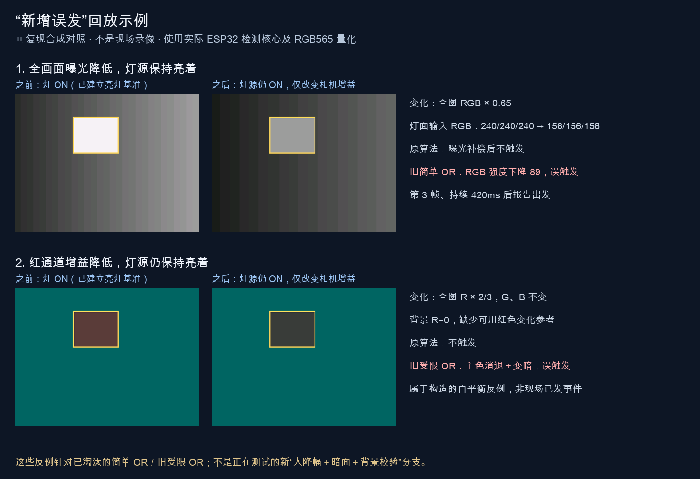

# 颜色因素与强 RGB OR 回测（2026-11-10）

本轮选用**强 RGB OR v2**：保留原 L* 熄灯判定，另设较严格的 RGB 补充通道。代码已整合到待发布源码；设备目前不可达，**尚未部署**。软件回放验收不等同真实红、绿灯实测。

两条通道共用背景稳定检查、固定灯面范围，以及至少3帧、400ms确认。RGB通道要求至少60%的同一批灯面像素，同时满足某一通道下降≥48且≥40%，并进入近黑/灰：最大通道≤96，且最大通道≤32或通道差≤12。对应通道的背景必须足以拟合全局曝光/白平衡；证据不足时RGB通道不可用。它不会否决原本合格的L*结果。

## 数据与方法

输入、ROI、人工标注依据、候选哈希及结果保存在[同名 JSON](颜色守卫回测-20261110.json)。原图和设备日志留在私有 `.maixpy`，不提交到Git；重放不需要设备密码或串口密钥。

| 实录组 | 使用帧数 | ROI（320×240） | 限制 |
| --- | ---: | --- | --- |
| ESP 20261107-a | 405 | `[124,40,64,44]` | 本次目视选取内核，约±4px；有4个大于750ms缺口 |
| ESP 20261109 trial-122729 | 157 | `[124,50,40,35]` | 既有人工内核与稳定窗；帧间隔中位2.87秒 |
| ESP 20261109 manual-2 | 74 | `[61,59,64,53]` | 操作员当时保存范围；帧间隔中位2.19秒 |

使用实际C++ `NativeDetector`、全画面编译、手动ROI及JPEG重新量化的RGB565。JPEG不是原始传感器帧。

原时间重放与稳定快照探针分开：后者使用不同实录图像，赋予210ms协议时间；部分OFF→ON→OFF探针重排稳定窗。它们检验光度/协议兼容性，不测物理延迟。**6个正探针来自3组图像的两种初态，不是6次独立实车试验**；12个稳态负探针也存在相关性。

## 最终 v2 结果

| 证据 | 结果 | 含义 |
| --- | --- | --- |
| 实录稳定快照 | 6/6正探针、12/12负探针保持 | 白/暖白样本无新增漏检或触发；新增RGB单独救援0次 |
| 11/7有效原时序ON初态 | 同帧`47.445862s`确认，跨度448ms | 原L*路径保持，不能当物理开关反应延迟 |
| 独立90例合成矩阵 | 新增8个正确熄灯识别，无新增误发或漏检 | 8例均为合成控制，包含两初态，不是8次真实彩灯试验 |
| 独立144例扩展矩阵 | 锁定、触发、首个确认时间、序列和原诊断均与基线等价 | 包括基线已知歧义；不是144例全部通过 |
| 17张旧Maix抖动图 | 两初态均0事件 | 无源时间戳、赋时210ms；跨相机补充压力测试 |

90/144合成矩阵由独立评审代理生成，本报告读取并比较其保存JSON；真实图像回放由本报告的重放脚本执行。源文件名及变更行见JSON的 `external_synthetic_evidence.strong_v2`。

11/7的`000218.jpg`已目视确认是灰暗灯面，所以0–50秒的过宽ON窗收窄为0–44秒，**47秒确认不能算误触**。严格OFF初态完整周期仍未验证：第二次熄灯前，`68.475715→69.284702s`缺失808.987ms，超过750ms连续性上限，ON基准被清除。11/9两组更稀疏，也不支持完整时序验收。

现有实录只有白/暖白，缺少真实红/绿周期、独立标注的遮挡或白平衡负例。真实图像上的RGB单独通道没有命中，因此不能把合成彩灯收益表述为实测召回率。缓存golden图片不算独立准确率样本。

## 被淘汰的旧候选

| 候选 | 淘汰证据 |
| --- | --- |
| A：统一`V下降≥8` AND | 真实暖白正探针从6/6降为4/6：灰度降约47.80，但暖色反射令V只降约3.15 |
| 旧简单OR | 同组扩展矩阵新增12个曝光误发 |
| 旧受限OR（P） | 额外完整白平衡扫描新增14个误发；早期较小子集曾报告4个 |
| C2/C3类最大通道否决 | 饱和、混合格栅及未饱和固定反光均有漏检反例；不能用“最大通道没下降”否决真实发光成分消退 |

以下两幅案例是**旧简单OR/旧受限OR的合成误发示例，不是新v2的结果，也不是实景误发录像**。灯保持ON的真值由生成过程规定：第一例整图曝光乘0.65；第二例整图R通道白平衡乘2/3。



[脱敏机器结果](assets/rgb-false-trigger-examples.json)与同名报告JSON的 `synthetic_display_inputs` 保存了纯数值场景、ROI、时间和变换参数，不含私有实图。通用真实图像重放脚本不负责合成这些展示图。

## 复现

需本机保留私有录制目录、C++编译器及项目Python依赖。脚本只读输入，输出JSON及帧SHA清单，不复制图像。

```sh
python esp32s3/video_preview/evaluate_color_guard.py \
  --manifest docs/颜色守卫回测-20261110.json \
  --data-root /path/to/private/.maixpy \
  --header esp32s3/video_preview/start_signal.h \
  --output /tmp/color-replay.json
```

修改`--header`可用同一范围与ROI复跑其他实现。基线来自提交`e355646dfc39498cd97994fa950137f005021cb7`，头文件SHA256为`388f8967225e22858e771b7a3dc28a5f3b2cbb9b76e92d3ec7c6d74bdb95e025`。v2已测头文件SHA256为`01488a74ce12ea9a6bb3f4a2d906f521f59c4b0bd07b5ba60a00ea0614ab7771`；JSON另保留旧候选哈希。旧候选仅有私有评估快照，删除后不能单靠哈希重建源码。

## 构建与回归

源码版本 Maix 0.6.85 / ESP32 0.4.17-strong-rgb-or。849 项 Python 回归运行完成：826 通过、23 项依赖本机原生库的可选检查跳过；页面 JS 回归通过。Maix 包和 ESP 固件构建通过，ESP 程序 1,717,061 字节，内部静态 RAM 132,836 字节，比前版增加 48 字节；RGB 参考图每检测器 14,400 字节在设备 PSRAM 中独立分配，失败只关闭 RGB 支路，原 L* 支路保留。模型权重未改。

通用重放脚本已用本报告清单再次执行生产头文件，首次确认位置和正负探针结果与已测 v2 一致，输出同时保留实际亮度/RGB 采用路径。
